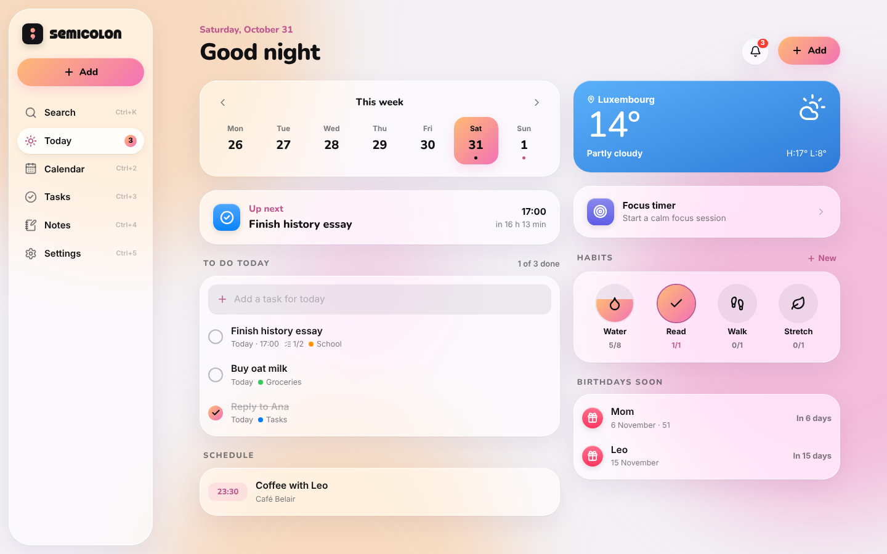
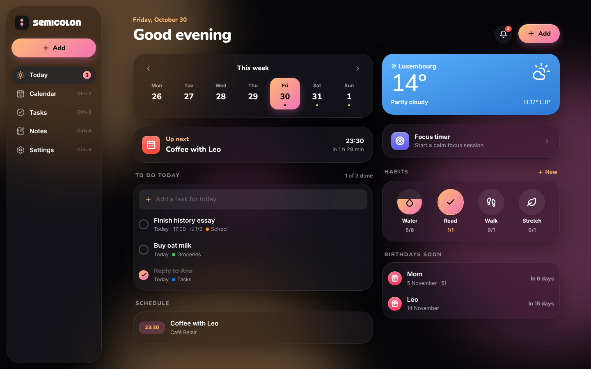
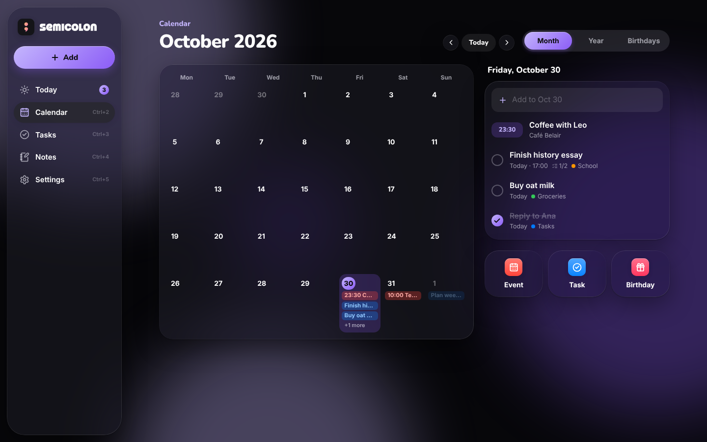
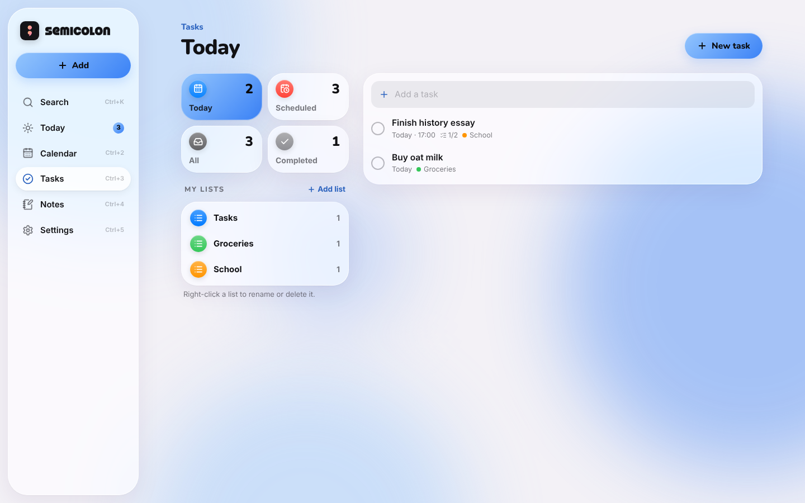
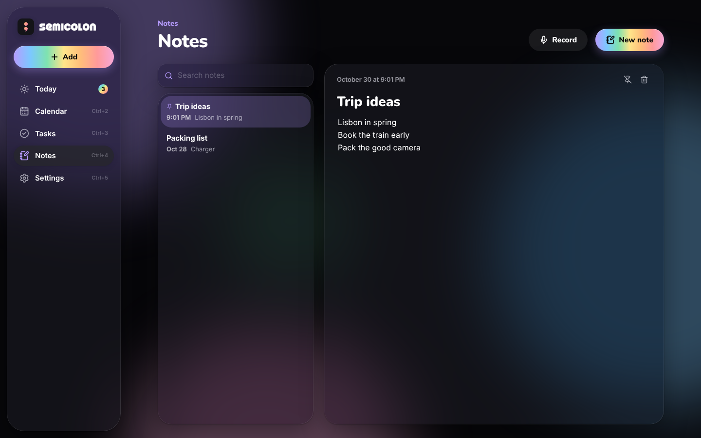
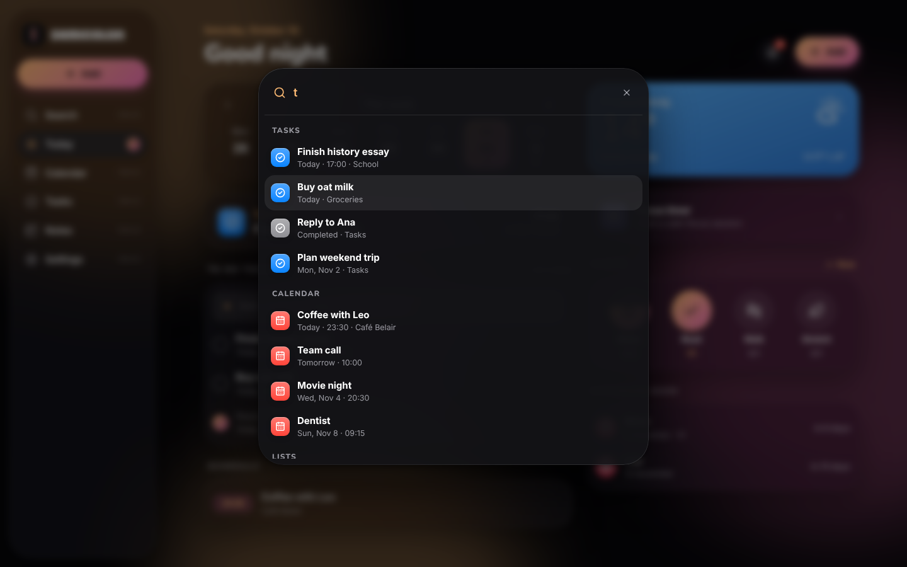
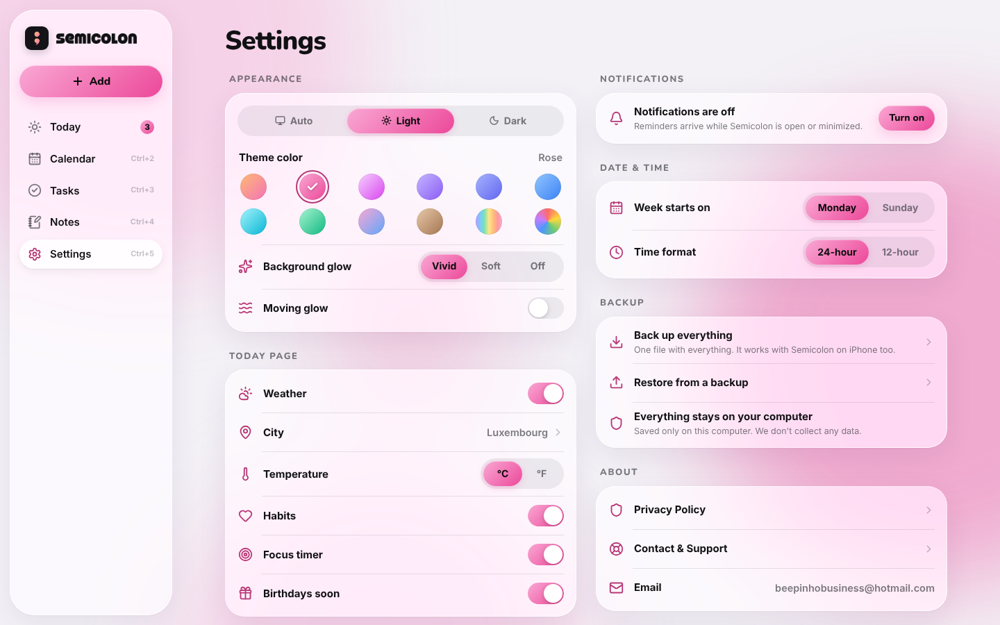
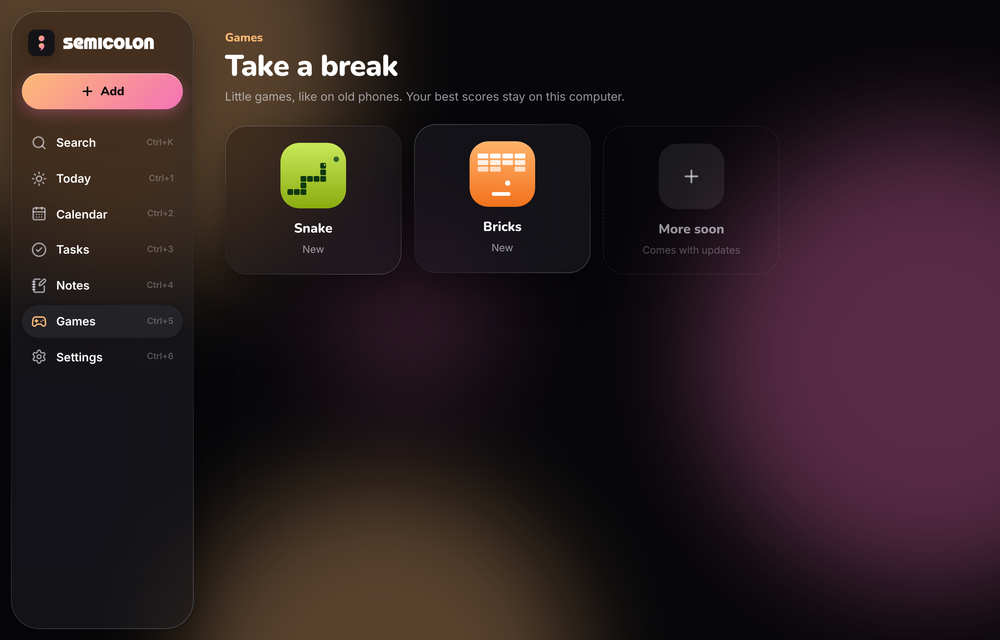

# Semicolon

Your day, calm and organized. Tasks, calendar, birthdays, habits, a focus timer, notes and little games for your breaks, in one glassy app for Mac and Windows. Everything stays on your own computer.

Made by beepinho. Free.

## Download

Go to **[Releases](../../releases/latest)** and pick your installer:

- **Mac:** `Semicolon_x.x.x_universal.dmg` — open it and drag Semicolon to Applications. Works on macOS 10.15 Catalina and newer, Intel and Apple Silicon.
- **Windows:** `Semicolon_x.x.x_x64-setup.exe` — open it. Semicolon opens when it's done, and you'll find it in the Start menu.

### Why your computer warns you the first time

Semicolon is a free app made by one person, so it isn't signed with a paid Apple or Microsoft certificate. Both systems warn about apps like that. You only see it the first time you open it.

- **Mac:** right-click Semicolon in Applications and choose **Open**, then **Open** again. On newer Macs you may need **System Settings → Privacy & Security → Open Anyway** instead.
- **Windows:** if it says *"Windows protected your PC"*, click **More info**, then **Run anyway**. If Windows Defender blocks it, that's a false alarm for the same reason: open **Windows Security → Protection history**, choose the Semicolon entry, then **Actions → Allow on device**.

Semicolon updates itself: when a new version is out, an Update button appears in the app.

## What it does

| | |
|---|---|
|  |  |
|  |  |

- **Today** — your week at a glance, what's up next, your to-do list, the weather, habits and upcoming birthdays.
- **Calendar** — month and year views, events that repeat, and birthdays with ages.
- **Tasks** — smart lists (Today, Scheduled, All, Completed) and your own colored lists with checklists.
- **Notes** — written notes and voice notes.
- **Holidays** (optional) — public holidays and special days for your country, in the calendar and on Today. Works offline.
- **Focus timer** — calm focus and break sessions that keep running while you use other apps.
- **Games for your breaks** — Snake and Bricks on a green old-phone screen. Your best scores stay on your computer, and you can hide the tab in Settings.
- **Reminders** — notifications for tasks, events and birthdays, even when the window is closed.
- **Search everything** — press **Ctrl + K** (**⌘ K** on Mac) to find any task, event, birthday, list or note.
- **Quick add from anywhere** — press **Ctrl + Shift + Space** (**⌘ ⇧ Space** on Mac) in any app, type "Dentist tomorrow 3pm", and it's added.
- **Runs quietly in the background** — closing the window keeps Semicolon next to the clock (Windows) or in the menu bar (Mac). Click the icon to open it again, or right-click for Quick add and Quit.
- **Starts with your computer** (optional) — as the icon or with its window open; choose in **Settings → In the background**.
- **Make it yours** — light and dark mode, 11 themes plus your own colors, and a soft moving glow.
- **Languages** — English, French, Portuguese, German and Spanish, following your computer.

## Closing and quitting

- **Close the window (✕)**: Semicolon keeps running as an icon so your reminders still arrive. You can turn this off in **Settings → In the background → Keep running when closed**.
- **Quit completely**: right-click the icon and choose **Quit Semicolon** (on Mac you can also press **⌘ Q**). Reminders only arrive while Semicolon is running.

## Keyboard shortcuts

| | Windows | Mac |
|---|---|---|
| Add something | Ctrl + N | ⌘ N |
| Search | Ctrl + K | ⌘ K |
| Quick add from any app | Ctrl + Shift + Space | ⌘ ⇧ Space |
| Today, Calendar, Tasks, Notes, Games, Settings | Ctrl + 1 to 6 | ⌘ 1 to 6 |

Games for your breaks:

## Privacy

Everything is saved only on your computer. Semicolon has no account and collects no data. The weather uses [Open-Meteo](https://open-meteo.com), and only your city's approximate location is sent. You can back everything up to one file in **Settings → Backup** and restore it on another computer, Windows or Mac.

## Support

Questions and problems: **beepinhobusiness@hotmail.com**

If Semicolon is useful to you: [buymeacoffee.com/beepinho](https://buymeacoffee.com/beepinho)

## Terms of use

Semicolon is provided as is, free of charge, without warranty of any kind. You are responsible for your own data and backups. beepinho is not liable for any loss of tasks, events, notes or other data, or for any damage arising from the use of Semicolon. By using it you accept this.

---

Made by beepinho · © beepinho. All rights reserved.
