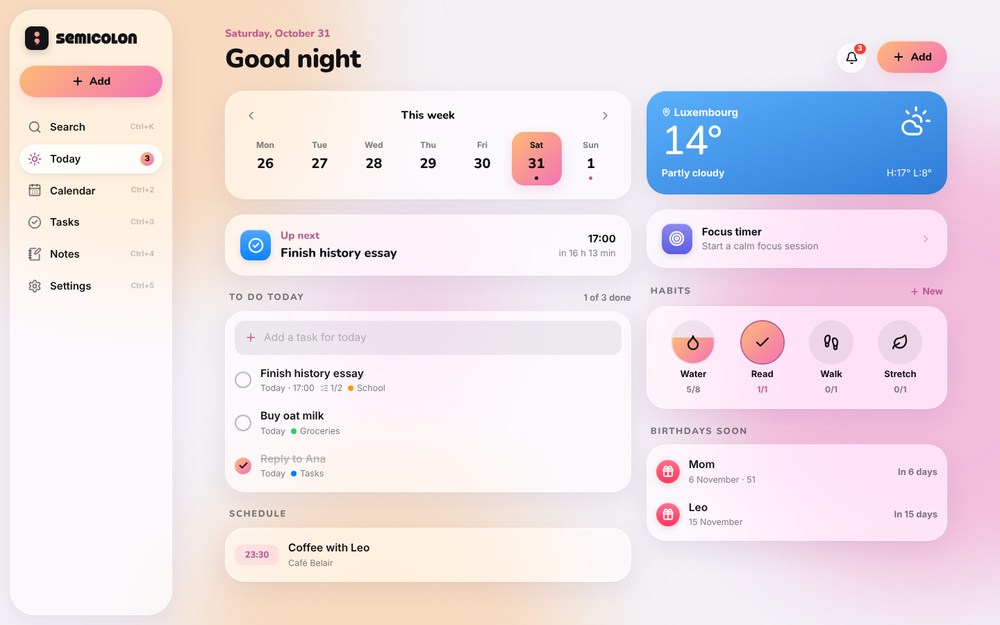
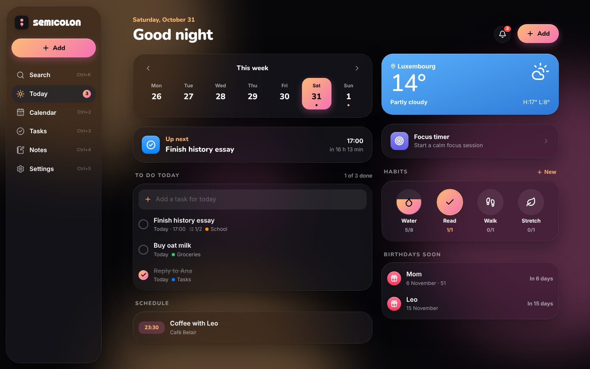
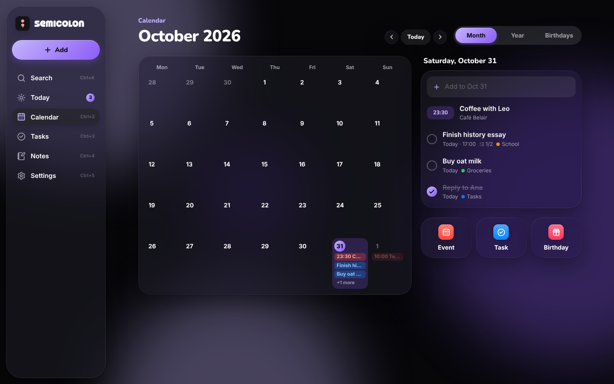
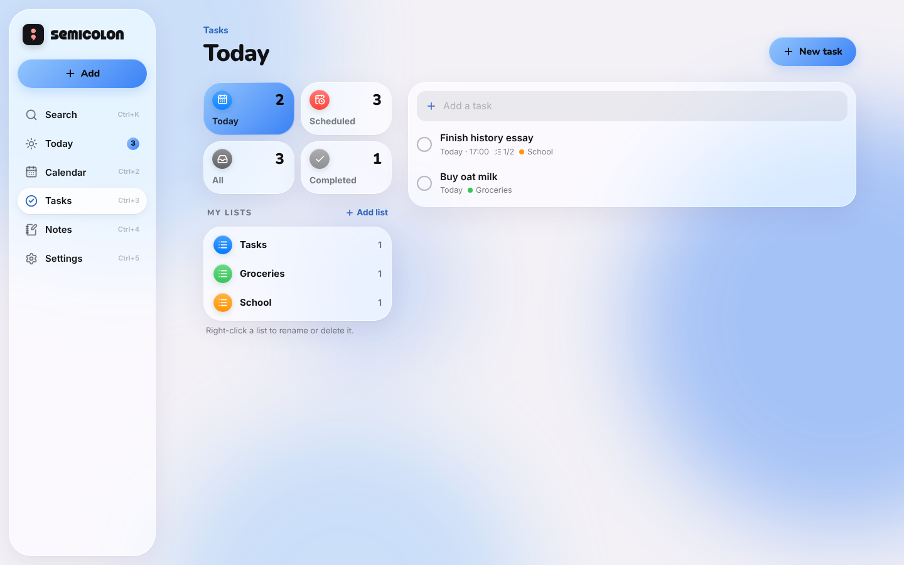
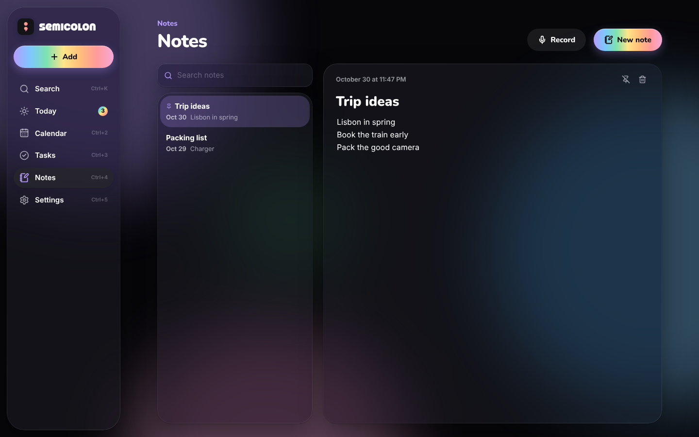
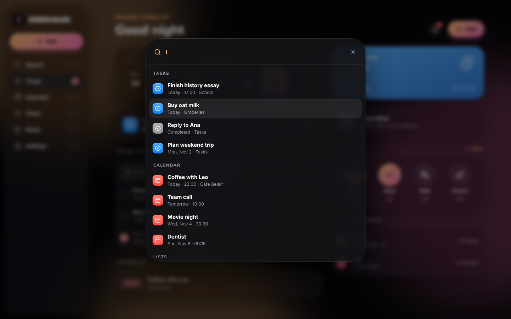
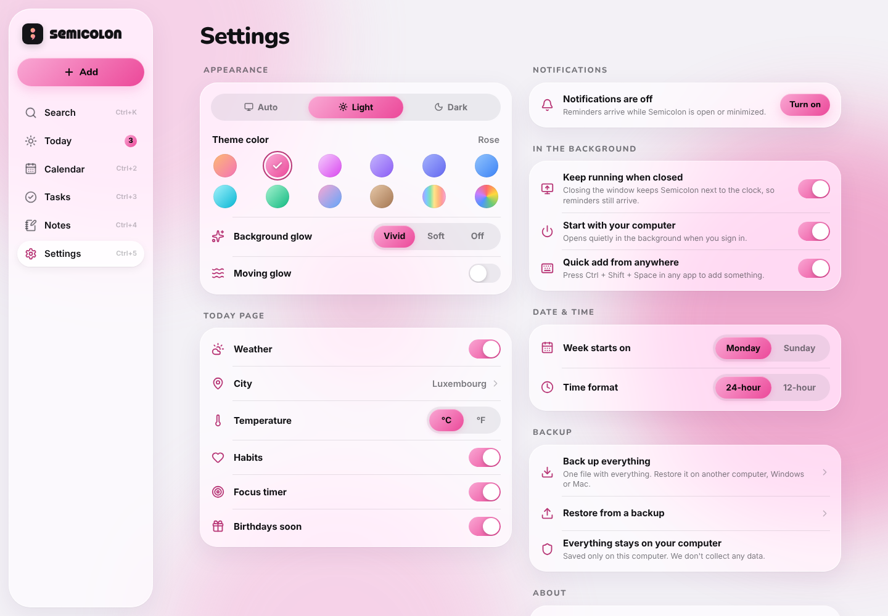

  

<h1 align="center">Semicolon</h1>

  Your day, calm and organized. 
  Tasks, calendar, birthdays, habits, a focus timer and notes, in one glassy little app. 
  Free for Windows and Mac.

  <a href="https://github.com/beepinho/semicolon-releases/releases/latest"><b>⬇ Download the latest version</b></a>

  

## What's inside

- **Today**: your week at a glance, what's up next, your to-do list, the weather, habits and upcoming birthdays.
- **Calendar**: month and year views, events that repeat, and birthdays with ages.
- **Tasks**: smart lists (Today, Scheduled, All, Completed) and your own colored lists with checklists.
- **Notes**: written notes and voice notes.
- **Focus timer**: calm focus and break sessions that keep running while you use other apps.
- **Reminders**: notifications for tasks, events and birthdays, even when the window is closed.
- **Search everything**: press **Ctrl + K** (**⌘ K** on Mac) to find any task, event, birthday, list or note.
- **Quick add from anywhere**: press **Ctrl + Shift + Space** (**⌘ ⇧ Space** on Mac) in any app, type "Dentist tomorrow 3pm", and it's added.
- **Runs quietly in the background**: closing the window keeps Semicolon next to the clock (Windows) or in the menu bar (Mac), and it can start with your computer.
- **Make it yours**: light and dark mode, 11 themes plus your own colors, and a soft moving glow.
- **Speaks your language**: English, Français, Português, Deutsch and Español, picked from your computer's language.
- **Updates itself**: when a new version is out, an Update button appears in the app.

  
  

  
  

  
  

## Download and install

Go to the **[latest release](https://github.com/beepinho/semicolon-releases/releases/latest)** and open **Assets**.

### Windows 10 and 11

1. Download **`Semicolon_x.x.x_x64-setup.exe`** and open it.
2. If Windows says *"Windows protected your PC"*, click **More info**, then **Run anyway**.
3. Semicolon opens when it's done, and you'll find it in the Start menu.
4. If Windows Defender blocks it, it's a false alarm because the app isn't paid-signed. Open **Windows Security → Protection history**, choose the Semicolon entry, then **Actions → Allow on device**.

### Mac (Apple Silicon and Intel, macOS 10.15 Catalina or newer)

1. Download **`Semicolon_x.x.x_universal.dmg`** and open it.
2. Drag **Semicolon** into **Applications**.
3. The first time, right-click Semicolon in Applications and choose **Open**, then **Open** again.
   On newer Macs you may need **System Settings → Privacy & Security → Open Anyway** instead.

> **Why the warning?** Semicolon is a free app made by one person, so it isn't signed with a paid Apple or Microsoft certificate. You only see the warning the first time you open it.

## Your data stays with you

Everything is saved only on your computer. Semicolon has no account and doesn't collect any data.
The weather uses [Open-Meteo](https://open-meteo.com), and only your city's approximate location is sent.

You can back everything up to one file in **Settings → Backup**, and restore it on another computer, Windows or Mac.

## Keyboard shortcuts

| | Windows | Mac |
|---|---|---|
| Add something | Ctrl + N | ⌘ N |
| Search | Ctrl + K | ⌘ K |
| Quick add from any app | Ctrl + Shift + Space | ⌘ ⇧ Space |
| Today, Calendar, Tasks, Notes, Settings | Ctrl + 1 to 5 | ⌘ 1 to 5 |

## Help

Questions or found a bug? Email **beepinhobusiness@hotmail.com**.

---

Made by beepinho · © beepinho. All rights reserved.

